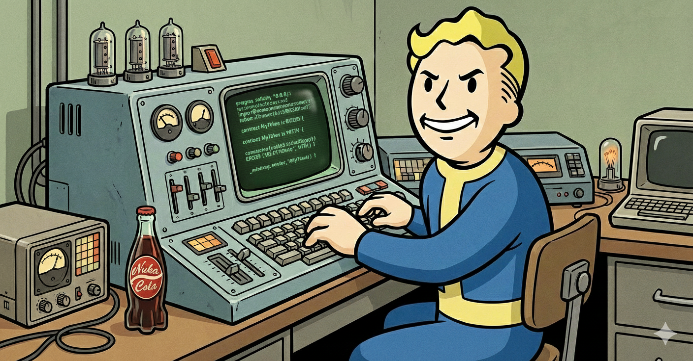
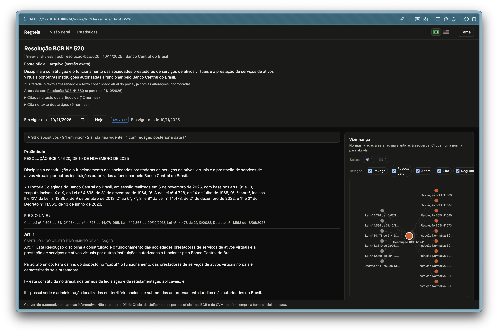
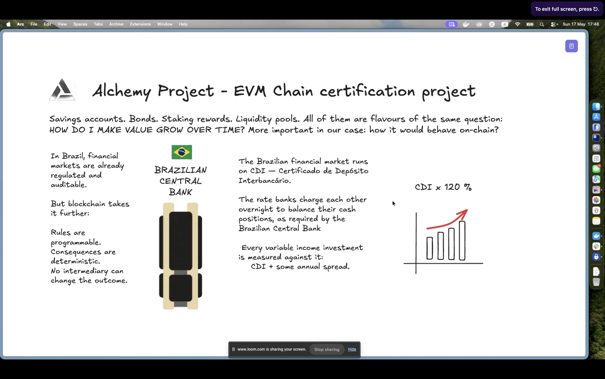
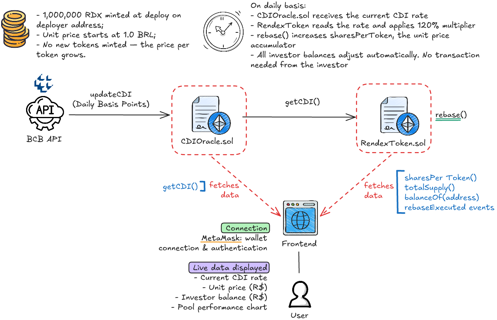
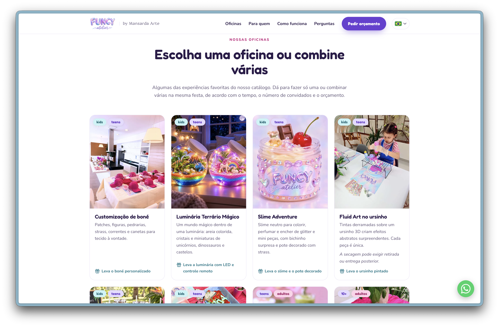
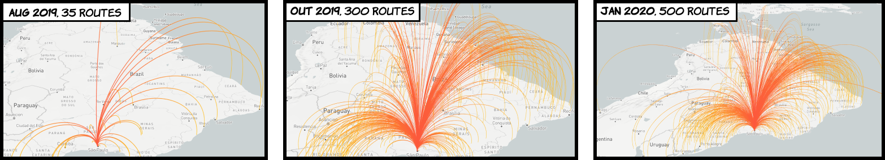

# About Me

Although my current role is focused on leading operations and management, overseeing processes, teams and strategic decisions, software development remains one of my biggest passions. In my free time, I dedicate myself to personal projects, either to learn something new or to experiment with technologies and solutions that can improve the projects I’m currently involved in.

It is important to note that several of my repositories are private due to the sensitive nature of the data and intellectual property involved. As such, some projects are referenced in this document solely for illustrative purposes and cannot be shared publicly.

## :balance_scale: RegTeia

[RegTeia](https://github.com/avirzin/regteia) turns Brazilian financial regulation (about 63,000 BCB, CMN and CVM norms) into a local graph. It shows which norm amends or revokes which, down to the article, and what was in force on any given date. You can explore it in the browser or ask an AI assistant through its MCP server.

<table>
  <tr>
    <td>
      
    </td>
    <td>
      
    </td>
  </tr>
</table>

## :test_tube: Rendex

[Rendex](https://github.com/avirzin/Rendex) is my capstone project for Alchemy University. It's a rebasing ERC-20 token on Sepolia whose balance grows daily with the CDI, which an oracle fetches from the Brazilian Central Bank.

<table>
  <tr>
    <td>
      
    </td>
    <td>
      
    </td>
  </tr>
</table>

## :briefcase: Creative Business Automation

I help my wife run her two creative brands, Mansarda Arte and FUNcy Atelier. My part is designing and automating their business processes.

<table>
  <tr>
    <td width="50%" valign="top">
      
      
<b>Mansarda Arte</b>: an art studio in São Paulo offering drawing and painting classes, workshops, commissioned paintings and corporate team-building, for all ages and skill levels.

    </td>
    <td width="50%" valign="top">
      
      
<b>FUNcy Atelier</b>: born inside Mansarda Arte, it brings hands-on creative workshops to parties and events, where guests make their own keepsake to take home.

    </td>
  </tr>
</table>

## :flying_saucer: Aerial Mobility

During my time at Flapper (the largest private aviation marketplace in Latin America), I focused on data analysis and operational insights, utilizing tools such as Mapbox and Deck.gl. My work included analyzing charter flight requests and identifying trends.

I have also explored future eVTOL operations through projects like Hoverfly, which visualizes eVTOL trajectories:

