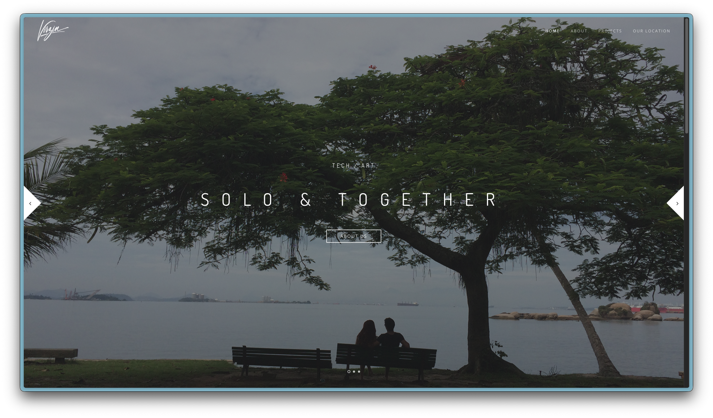
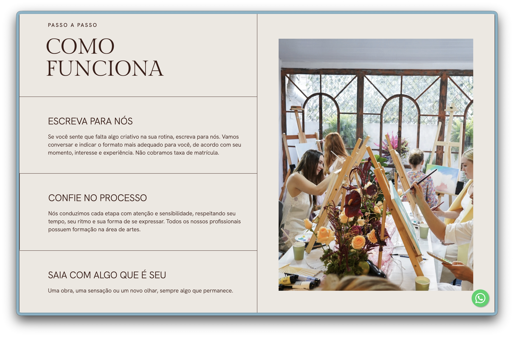

# About Me

Although my current role revolves around analyzing and specifying products as well as handling operational tasks, software development remains one of my biggest passions. In my free time, I dedicate myself to personal projects, either to learn something new or to experiment with technologies and solutions that can improve the projects I’m currently involved in.

It is important to note that several of my repositories are private due to the sensitive nature of the data and intellectual property involved. As such, some projects are referenced in this document solely for illustrative purposes and cannot be shared publicly.

## :scales: RegTeia

[RegTeia](https://github.com/avirzin/regteia) turns Brazilian financial regulation (about 63,000 BCB, CMN and CVM norms) into a local graph. It shows which norm amends or revokes which, down to the article, and what was in force on any given date. You can explore it in the browser or ask an AI assistant through its MCP server.

## :test_tube: Rendex

[Rendex](https://github.com/avirzin/Rendex) is my capstone project for Alchemy University. It's a rebasing ERC-20 token on Sepolia whose balance grows daily with the CDI, which an oracle fetches from the Brazilian Central Bank.

## :art: One-pager websites

I also maintain a couple of basic static websites hosted on S3 buckets, which work as a public-facing portfolio for some of my projects.

<table>
  <tr>
    <td>
      
    </td>
    <td>
      
    </td>
  </tr>
</table>

## :flying_saucer: Aerial Mobility

During my time at Flapper (the largest private aviation marketplace in Latin America), I focused on data analysis and operational insights, utilizing tools such as Mapbox and Deck.gl. My work included analyzing charter flight requests and identifying trends.

I have also explored future eVTOL operations through projects like Hoverfly, which visualizes eVTOL trajectories:

